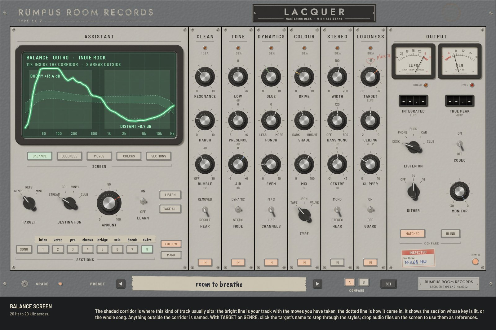

# Lacquer

A mastering desk with an assistant, by Rumpus Room Records, for Logic's master bus.
Six modules in a row (CLEAN, TONE, DYNAMICS, COLOUR, STEREO, LOUDNESS), an OUTPUT
section with two needle meters, and an ASSISTANT that listens to the song once, draws
its balance against a target on a green tube, and suggests moves you take or skip with
a click. The faceplate is TYPE LK 7, in the family of Sam's Desk and Kontur.

Songs change as they go, so Lacquer has eight section keys (intro, verse, pre-chorus,
chorus, bridge, solo, breakdown and outro to start with; rename any of them). Tap them as
the song plays to mark where each part starts, then give a section its own settings:
less glue and a little more width in the chorus, some space in the bridge, and its own
loudness TARGET, so the verses can sit a dB or two under the choruses instead of the
limiter flattening them together. Changes glide in over a beat. FOLLOW lights the key
for the section you're in as the song plays; press a key while it plays to hold that
section and work on it. Long player's SPACE controls live on a tray that drops out from
under the desk at a quarter turn of the latch.

## Where the build is

| Step | What | State |
| --- | --- | --- |
| 1 | Engine: CLEAN, TONE, DYNAMICS, COLOUR, STEREO, LOUDNESS (learnt drive, true-peak limiter, clipper, GUARD), OUTPUT (LISTEN ON, dither, MONITOR, matched IN switches), SPACE | **done, tested** |
| 2 | Sections: eight named keys, the song map, per-section settings (loudness TARGET included), glides, FOLLOW, editing the map on the screen (pick, retype, split, join, mark at the playhead) | **done, tested** |
| 3 | Assistant: the listening pass, balance against a genre, your references or your own masters; moves, the loudness knee, section lift, checks, mix notes, LEARN | **done, tested** |
| 4 | Faceplate art: bare panel, SPACE tray, lit patches, selector | **done at preview quality**; final-quality render to do |
| 5 | The plugin (JUCE, Audio Unit): the five screen pages, sections, the tray, presets, A/B and BLIND, reference drop, hover help, window sizes | **first version done** |
| 6 | CODEC (hear the master after streaming encoding) | to do: the switch moves but does nothing |
| 7 | Mac build, auval and pluginval on every push | **running** |

## Installing

Get `lacquer-<version>-mac` from the newest green run on the Actions page, open the
disk image, quit Logic, and in Terminal run:

    bash "$(ls -td /Volumes/lacquer*/ | head -1)install.sh"

Then, on the stereo output: Audio FX > Audio Units > Rumpus Room Records > Lacquer.

## How it works, briefly

**LOUDNESS** works out its own drive: the target less the loudness the limiter's input
measured. The first time the song plays it learns that measurement, and from then on
the drive is fixed while the song plays (so the song keeps its own rises and falls)
and is recalibrated only when it stops. GUARD reads the listening pass's peak
statistics to find the loudness where the limiter starts eating transients (the knee)
and won't drive past it. The limiter is true-peak, after an optional soft clipper.

**The listening pass** feeds the input, before any processing, to a 4096-point
analyser in sixth-octave bands (mid and side), a BS.1770 loudness meter, a peak
histogram and a few checks (phase, DC, the start and end). It keeps every section
apart. The assistant compares each against the target corridor and suggests moves:
song-wide where the whole song is off, for one section where only that section is
(a harsh chorus gets a chorus-only HARSH move). AMOUNT scales the relative moves you
have taken. With LEARN on, what you take and skip shifts what it suggests next time.

**Sections** are marks in the song map (bar positions and a key). A section's own
settings are only the ones it changes; everything else follows the song, so changing
the song's glue changes every section that hasn't set its own. A section's own TARGET
moves its drive: a verse at -11 LUFS against a song at -9.4 is driven 1.6 dB less, so
it plays quieter and keeps more of its peaks, while the choruses stay where they were.
CEILING, CLIPPER, GUARD and OUTPUT are song-wide.

**Section lift.** Pushed hard, the limiter works most on the loudest section, so it
evens the song out: in the tests, choruses that sat 4.4 dB over the verses in the mix
came out only 1.8 dB over them. The listening pass measures each section's loudness
going into the limiter and coming out, and the assistant suggests a lower TARGET for
the quieter sections to give some of that lift back (and, when the limiter takes more
than 2 dB off the loudest section, a little less GLUE there to keep its punch). The
LOUDNESS screen shows how far the loudest section stands over the others, in the mix
and as it will come out with the targets as they are.

From `tests/engine_tests.cpp` (26 checks) on the Linux build machine: loudness lands
within 0.2 dB of the target after one pass, true peak stays under the ceiling, the
sound is the same at any host block size, a bounce leaves out MONITOR and LISTEN ON,
and everything on costs 23% of one core at 48 kHz. Latency is 903 samples (19 ms) at
48 kHz. `tests/plugin_selftest.cpp` drives the real processor through a playhead:
two plays, marking sections by tapping the keys (playing and stopped), FOLLOW, split
and join, a listening pass, section contrast, taking and skipping moves, A/B, presets,
saving and restoring a session, mono, and odd block sizes.

## Layout

- `engine/` header-only C++17, no dependencies: `lq_params.hpp` (the parameters),
  `lq_modules.hpp` (the modules), `lq_engine.hpp` (the chain, sections, loudness),
  `lq_analysis.hpp` (the listening pass), `lq_assistant.hpp` (targets, moves, checks).
  `lp_*.hpp` come from long player (saturation, compressor, width, space, limiter,
  dither), `kt_*.hpp` from Kontur (filters, FFT).
- `plugin/` the JUCE plugin: `PluginProcessor` (audio, the pass, the assistant,
  sections, presets, A/B, state), `PluginEditor` (the window, painted over the rendered
  faceplate, and the tube's pages), `Layout.h` and `HelpText.h` (generated by
  `art/gen_layout_h.py`), `assets/` (packed by `art/pack_assets.py`).
- `tests/` `engine_tests.cpp`, `plugin_selftest.cpp`, `ui_snapshot.cpp` (renders the
  window to PNGs without a host); `testsig.hpp` makes the synthetic test song.
  `cmake -B build && cmake --build build && ctest --test-dir build --output-on-failure`.
- `art/` the faceplate pipeline (Blender via `bpy`): `layout.py` is the single source
  of control positions and legends, `make_textures.py` draws the printed legends,
  meter faces and tapes, `render.py panel|tray [--draft|--preview] [--state bare|amber|green]`
  renders. `art/mockup/` builds the interactive mockup from the same layout.
- `packaging/` the installer script and the disk image's READ ME.

The plugin is built with JUCE (AGPLv3 or a commercial JUCE licence); fonts are
Barlow Semi Condensed and Caveat Brush (SIL Open Font License, `plugin/fonts`).
