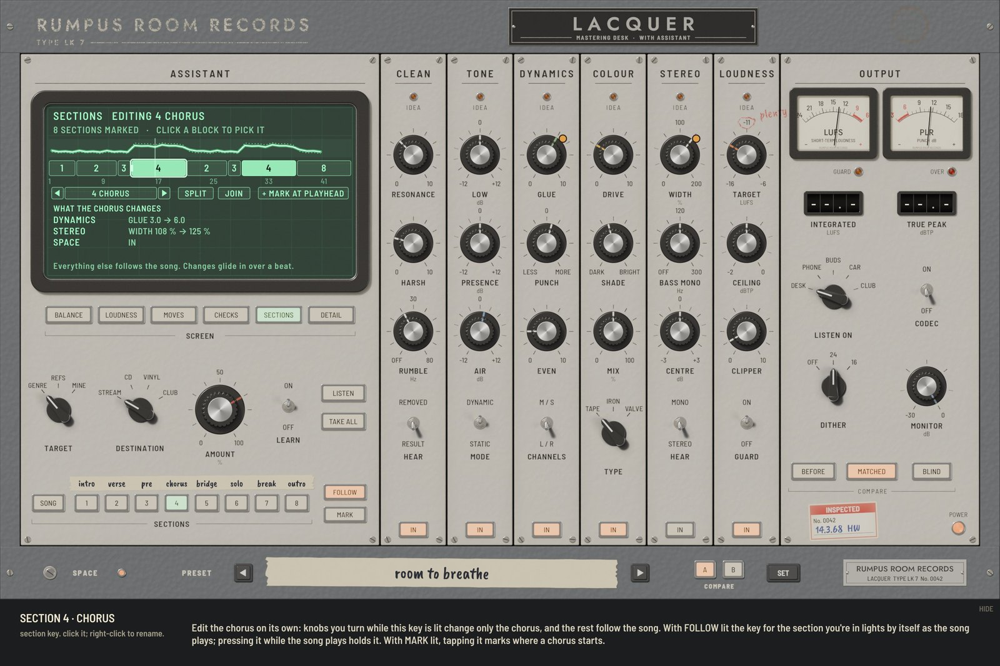
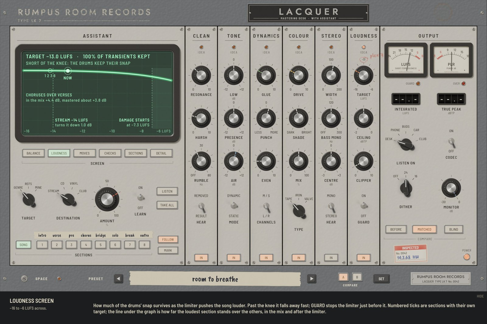
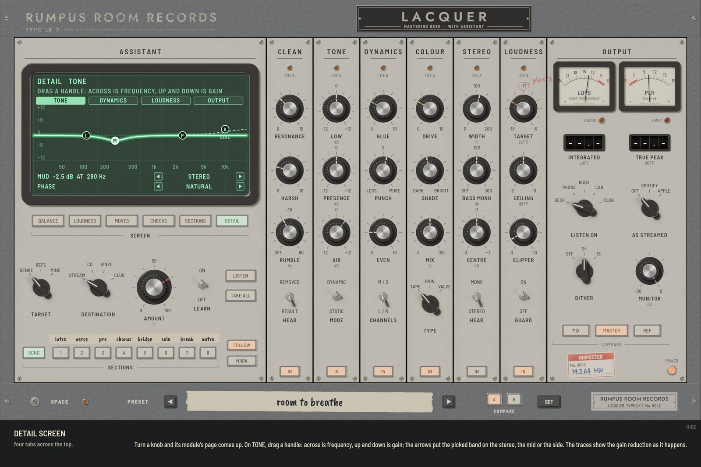
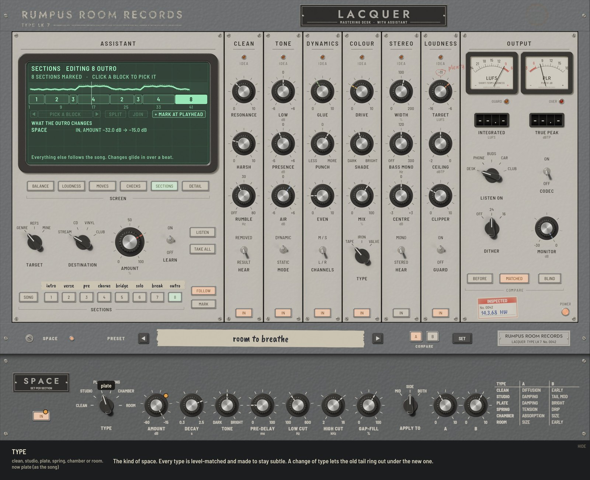

# Lacquer

A mastering desk with an assistant, by Rumpus Room Records, for Logic's master bus.
Six modules in a row (CLEAN, TONE, DYNAMICS, COLOUR, STEREO, LOUDNESS), an OUTPUT
section with two needle meters, and an ASSISTANT that listens to the song once, draws
its balance against a target on a green tube, and suggests moves you take or skip with
a click. The faceplate is TYPE LK 7, in the family of Sam's Desk and Kontur.

Songs change as they go, so Lacquer has eight section keys (intro, verse, pre-chorus,
chorus, bridge, solo, breakdown and outro to start with; rename any of them). Tap them as
the song plays to mark where each part starts, then give a section its own settings:
less glue and a little more width in the chorus, some space in the bridge, and its own
loudness TARGET, so the verses can sit a dB or two under the choruses instead of the
limiter flattening them together. Changes glide in over a beat. FOLLOW lights the key
for the section you're in as the song plays; press a key while it plays to hold that
section and work on it. Long player's SPACE controls live on a tray that drops out from
under the desk at a quarter turn of the latch.







## Where the build is

| Step | What | State |
| --- | --- | --- |
| 1 | Engine: CLEAN, TONE, DYNAMICS, COLOUR, STEREO, LOUDNESS (learnt drive, true-peak limiter, clipper, GUARD and its automatic ceiling), OUTPUT (LISTEN ON, dither, MONITOR, loudness-matched IN switches), SPACE | **done, tested** |
| 2 | Sections: eight named keys, the song map, per-section settings (loudness TARGET included), glides, FOLLOW, editing the map on the screen (pick, retype, split, join, mark at the playhead) | **done, tested** |
| 3 | Assistant: the listening pass (by itself on a new song's first play), balance against a genre, your references or your own masters; moves, the loudness knee, section lift, checks, mix notes, LEARN; style curves calibrated on released records | **done, tested** |
| 4 | TONE as a four-band mastering EQ (low, mud, presence, air) with set frequencies, mid/side per band and linear phase; GLUE's attack, release and ratio; the limiter's style and release | **done, tested** |
| 5 | COMPARE: MIX (the mix, lined up), MASTER or REF (a reference song in time with it), all at the master's loudness; gain-reduction traces, an input meter, the song's loudness bar by bar | **done, tested** |
| 6 | AS STREAMED: the master through Apple's AAC encoder and back, turned to Spotify's or Apple Music's level, with the true peak after encoding | **done** (the encoder is Mac only; tested in the Mac build) |
| 7 | Faceplate art: bare panel, SPACE tray, lit patches, selector | **done at preview quality**; final-quality render to do |
| 8 | The plugin (JUCE, Audio Unit): six screen pages, sections, the tray, presets, A/B and blind A/B, references (dropped or chosen) and styles made from them, hover help that folds away, a value beside a turning knob, window sizes | **done** |
| 9 | Mac build, auval and pluginval on every push | **running** |

## Installing

Get `lacquer-<version>-mac` from the newest green run on the Actions page, open the
disk image, quit Logic, and in Terminal run:

    bash "$(ls -td /Volumes/lacquer*/ | head -1)install.sh"

Then, on the stereo output: Audio FX > Audio Units > Rumpus Room Records > Lacquer.

## How it works, briefly

**LOUDNESS** works out its own drive: the target less the loudness the limiter's input
measured. Until it has heard the song, GUARD keeps the target to -13 LUFS, and a safety
hold never pushes any stretch of the song more than 5 dB past the target, so a figure
learnt from a quiet intro can't crush the chorus that follows. It learns the song bar by bar: every bar you play is filed, each
bar once, so a loop of the chorus can't pass for the whole song, and the DETAIL screen
says how much of the song the figure rests on. The drive is fixed while the song plays
(so the song keeps its own rises and falls) and moves only when it stops. GUARD finds
the loudness where the limiter starts eating transients (the knee) from the peaks at
the limiter's own input, after PUNCH and the rest, and won't drive past it. The limiter
is true-peak, after an optional soft clipper, in three styles: CLEAN, PUNCHY, DENSE.
Before both, LOW END FIRST splits off everything under 120 Hz: when the low end is what
pushes a moment over the ceiling (a kick, a bass note's attack), it comes off the low
end, up to 6 dB, instead of the limiter turning the whole mix down, which is what makes a
limited mix pump on every kick. A low end that stays over the ceiling loses no more than
2 dB this way; the limiter takes the rest evenly. In the tests, a kick 6 dB over the
ceiling ducked a steady tone by 2 dB without it and 0.4 dB with it.

**TONE** has four bands, each +-12 dB: a low shelf (40-250 Hz), a mud bell (120-800 Hz),
a presence bell (1-6 kHz) and an air shelf (5-18 kHz). The faceplate's knobs set three gains; the
DETAIL screen has all four, their frequencies, and puts each on the stereo, the mid or
the side. In natural phase it adds no delay and can work dynamically; in linear phase
it is one symmetric FIR on the mid and one on the side (48 ms of delay at 44.1/48 kHz),
rebuilt off the audio thread and crossfaded in as the settings move.

**COMPARE** is one of three: MIX plays the mix as it came in, delayed to line up with
the master; MASTER is what the bounce gets; REF plays a reference song (chosen the first
time you press it, or from the SET menu) at the same point in time, wrapped round if
it's shorter. MIX and REF are turned to the master's loudness (REF from its integrated
loudness, measured when it's read in), so you compare the sound and not the level.
**AS STREAMED** plays the master the way Spotify (-14 LUFS) or Apple Music (-16 LUFS)
will: through Apple's AAC encoder and back on a worker thread (Mac), then turned down
if it's louder than the service's level, or up if it's quieter, only as far as its true
peak leaves 1 dB. The DETAIL screen shows what each service does to it and the true
peak after encoding. None of these reaches a bounce, and the encoder's few thousand
samples of delay aren't reported to the host.

**The automatic ceiling.** With GUARD on, the limiter's ceiling drops to -2 dBTP when
the master is aimed louder than -14 LUFS (Spotify asks for this: loud masters pick up
more overs when encoded). The knob still sets it otherwise, and the TRUE PEAK check
reads against the ceiling in force.

**Starting by itself.** A new Lacquer listens on the song's first play without LISTEN
being pressed. Once it has heard at least 40 seconds and the song stops, it takes the
moves it's at least 70% sure of (at AMOUNT) and leaves the rest on MOVES. It does this
once per instance, never in a saved session, and SET > "Start the assistant by itself"
turns it off.

**The listening pass** feeds the input, before any processing, to a 4096-point
analyser in sixth-octave bands (mid and side), a BS.1770 loudness meter, a peak
histogram and a few checks (phase, DC, the start and end). It keeps every section
apart. The assistant compares each against the target corridor and suggests moves:
song-wide where the whole song is off, for one section where only that section is
(a harsh chorus gets a chorus-only HARSH move). AMOUNT scales the relative moves you
have taken. With LEARN on, what you take and skip shifts what it suggests next time.

**Where the targets come from.** The style curves start from the average balance of
twelve released, professionally mixed and mastered songs (indie, rock, metal, pop, R&B,
electronic, hip-hop, acoustic; CC-licensed releases) measured with this analyser, bent a
little for each style. Against pink noise they fall about 1.5 dB an octave from 100 Hz
to 4 kHz and faster above, the shape Pestana et al. (AES 2013) found across commercial
records from 1950 to 2010. The corridor is as wide as those records spread (about one
standard deviation, band by band): inside it is taste, and a TONE move is suggested
only once a band's average leaves it. `lacquer_analyse` (built with the tests) runs
any finished songs through the pass and the assistant, so the calibration can be
checked on more records:

```
build/lacquer_analyse_artefacts/Release/lacquer_analyse --style 0 song.wav ...
```

On those twelve records the assistant suggests one or two TONE moves a song, mostly at
45 to 60% confidence; the opening settings turn each down to about -12.5 LUFS with
1.5 to 2 dB of glue on average and the limiter all but idle, keep the loudness range,
and hold the true peak at -1 dBTP. Ten of the twelve are flagged as already limited,
and the two gentle masters aren't.

**Sections** are marks in the song map (bar positions and a key). A section's own
settings are only the ones it changes; everything else follows the song, so changing
the song's glue changes every section that hasn't set its own. A section's own TARGET
moves its drive: a verse at -11 LUFS against a song at -9.4 is driven 1.6 dB less, so
it plays quieter and keeps more of its peaks, while the choruses stay where they were.
CEILING, CLIPPER, GUARD and OUTPUT are song-wide.

**Section lift.** Pushed hard, the limiter works most on the loudest section, so it
evens the song out: in the tests, choruses that sat 4.4 dB over the verses in the mix
came out only 1.8 dB over them. The listening pass measures each section's loudness
going into the limiter and coming out, and the assistant suggests a lower TARGET for
the quieter sections to give some of that lift back (and, when the limiter takes more
than 2 dB off the loudest section, a little less GLUE there to keep its punch). The
LOUDNESS screen shows how far the loudest section stands over the others, in the mix
and as it will come out with the targets as they are.

From `tests/engine_tests.cpp` (39 checks) on the Linux build machine: loudness lands
within 0.2 dB of the target after one pass, true peak stays under the ceiling, the
sound is the same at any host block size, a bounce leaves out MONITOR and LISTEN ON,
and everything on costs 23% of one core at 48 kHz. Latency is 903 samples (19 ms) at
48 kHz. `tests/plugin_selftest.cpp` drives the real processor through a playhead:
two plays, marking sections by tapping the keys (playing and stopped), FOLLOW, split
and join, a listening pass, section contrast, taking and skipping moves, A/B, presets,
saving and restoring a session, mono, and odd block sizes.

## Layout

- `engine/` header-only C++17, no dependencies: `lq_params.hpp` (the parameters),
  `lq_modules.hpp` (the modules), `lq_engine.hpp` (the chain, sections, loudness),
  `lq_analysis.hpp` (the listening pass), `lq_assistant.hpp` (targets, moves, checks).
  `lp_*.hpp` come from long player (saturation, compressor, width, space, limiter,
  dither), `kt_*.hpp` from Kontur (filters, FFT).
- `plugin/` the JUCE plugin: `PluginProcessor` (audio, the pass, the assistant,
  sections, presets, A/B, state), `PluginEditor` (the window, painted over the rendered
  faceplate, and the tube's pages), `Layout.h` and `HelpText.h` (generated by
  `art/gen_layout_h.py`), `assets/` (packed by `art/pack_assets.py`).
- `tests/` `engine_tests.cpp`, `plugin_selftest.cpp`, `ui_snapshot.cpp` (renders the
  window to PNGs without a host); `testsig.hpp` makes the synthetic test song.
  `cmake -B build && cmake --build build && ctest --test-dir build --output-on-failure`.
- `art/` the faceplate pipeline (Blender via `bpy`): `layout.py` is the single source
  of control positions and legends, `make_textures.py` draws the printed legends,
  meter faces and tapes, `render.py panel|tray [--draft|--preview] [--state bare|amber|green]`
  renders. `art/mockup/` builds the interactive mockup from the same layout.
- `packaging/` the installer script and the disk image's READ ME.

The plugin is built with JUCE (AGPLv3 or a commercial JUCE licence); fonts are
Barlow Semi Condensed and Caveat Brush (SIL Open Font License, `plugin/fonts`).
